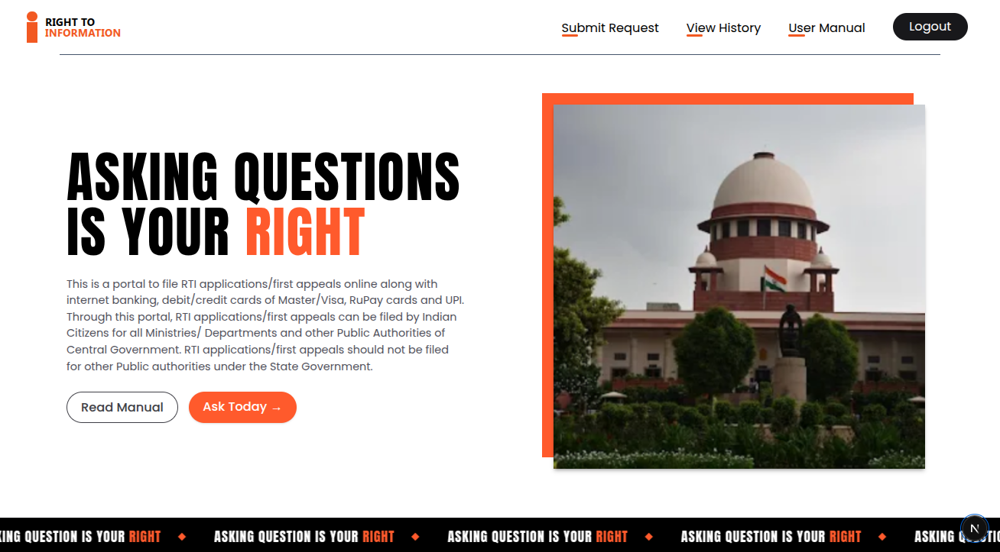

**A Modern redesign of Indian RTI website, Built for [buildwhatmovesindia](https://buildwhatmovesindia.com/) hackathon**

### Technologies Used:
- canva:   for UI design
- reactjs: frontend
- nextjs:  backend
- appwrite: database
- groq:    for ai api

### Run Locally
```
git clone https://github.com/CYCNO/RTI-Web-Redesign.git
cd RTI-Web-Redesign
npm i && npm run dev
```
---
> Not to be affiliated by GOV of India
